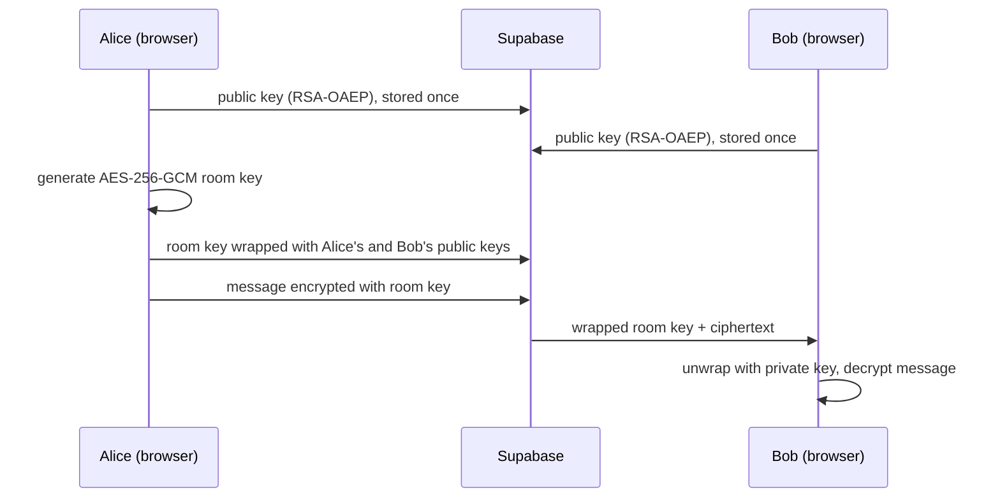

# Pulse: End-to-End Encrypted Real-Time Chat

A real-time messaging web app where message and file contents are encrypted in the browser before they reach the server. Built for Season of Code, WnCC IIT Bombay.

## Features

- **End-to-end encrypted messages and files** using the Web Crypto API: each chat has an AES-256-GCM room key, wrapped for every participant with their RSA-OAEP public key.
- **Real-time delivery** with Supabase Realtime channels; typing indicators and read receipts.
- **Group chats**, replies, message deletion, media and file sharing (files are encrypted before upload).
- **Voice calls** over WebRTC, with signalling through Supabase channels and a call history view.
- **Local message cache** in IndexedDB (via localForage) so past conversations are readable offline.
- **Auth** with Supabase Auth and protected routes.

## How the encryption works



The server stores only ciphertext and wrapped keys.

## Tech stack

React 19, Vite, React Router, Supabase (Postgres, Auth, Storage, Realtime), Web Crypto API, WebRTC, localForage, plain CSS.

## Quick start

```bash
git clone https://github.com/GunjanRoy4224/SOC-Chat-app.git
cd SOC-Chat-app
npm install
```

Create `.env` with your Supabase project values, then start the dev server:

```bash
VITE_SUPABASE_URL=https://<your-project>.supabase.co
VITE_SUPABASE_ANON_KEY=<your-anon-key>
```

```bash
npm run dev
```

## Structure

```text
src/components/   chat window, sidebar, message bubble, calls view, modals
src/context/      AuthContext (session, presence, key setup)
src/hooks/        useWebRTC (call handling)
src/lib/          crypto.js (key generation, wrap/unwrap, AES-GCM), Supabase client
PROJECT_REPORT.md  full design write-up
```

## Security limitations

This is a learning project, not an audited secure messenger.

- The RSA private key is stored in `localStorage` for each browser. Anyone with script access to the page (for example through an XSS bug) could read it. Wrapping it with a passphrase-derived key would be the next step.
- Keys are per browser: signing in on a new browser or device generates a new key pair, so earlier encrypted messages are not readable there. Multi-device key sync is not implemented.
- No key verification (safety numbers), forward secrecy or metadata protection; the server still sees who talks to whom and when.
